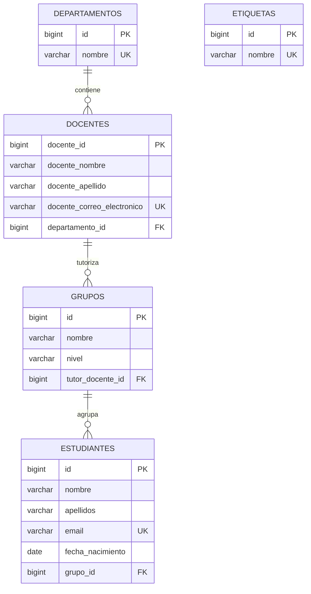

# Cómo guardamos los datos de CampusHub

## PostgreSQL: tablas y relaciones

En el diagrama, `PK` es la clave primaria, `FK` es una clave foránea y `UK` indica
un campo que no se puede repetir.



Un departamento puede tener varios docentes, un docente puede ser tutor de
varios grupos y un grupo puede tener varios estudiantes. Cada docente tiene un
departamento, cada grupo un tutor y cada estudiante un grupo.

Las etiquetas están en PostgreSQL, pero su relación con las actividades se
guarda en MongoDB.

Todos los campos del diagrama son obligatorios. Los identificadores se generan
automáticamente.

| Tabla | Reglas de sus campos |
|---|---|
| `departamentos` | Nombre de hasta 100 caracteres, sin repetir. |
| `docentes` | Nombre, apellido y correo de hasta 250 caracteres. El correo no se puede repetir. El departamento debe existir. |
| `grupos` | Nombre y nivel de hasta 100 caracteres. El tutor debe existir. El nombre del grupo sí se puede repetir. |
| `estudiantes` | Nombre y apellidos de hasta 100 caracteres. Email de hasta 50, sin repetir. La fecha de nacimiento debe ser anterior a hoy y el grupo debe existir. |
| `etiquetas` | Nombre de hasta 100 caracteres, sin repetir. |

En las tablas, `NOT NULL` impide dejar un campo sin valor, `UNIQUE` impide
repeticiones y `CHECK` comprueba la fecha de nacimiento. El servicio también
rechaza los textos obligatorios vacíos y comprueba el formato del correo.

No convertimos los correos a minúsculas antes de guardarlos. Tampoco borramos
registros relacionados automáticamente: no se puede borrar un departamento si
todavía tiene docentes, por ejemplo. La API no incluye operaciones de borrado.

### Índices de PostgreSQL

Un índice ayuda a encontrar los datos de una búsqueda. Estos son los que hemos
añadido para las relaciones:

| Nombre | Campo | Para qué sirve |
|---|---|---|
| `ix_estudiantes_grupo` | `estudiantes.grupo_id` | Buscar los estudiantes de un grupo. |
| `ix_docentes_departamento` | `docentes.departamento_id` | Buscar los docentes de un departamento. |
| `ix_grupos_tutor` | `grupos.tutor_docente_id` | Buscar los grupos de un tutor. |

Las claves primarias y los campos `UNIQUE` ya tienen sus propios índices.
Los tres de la tabla están en las entidades con `@Index` y en
`indices_postgres.sql`.

## MongoDB: colecciones

La base se llama `campushub`. Las colecciones son donde MongoDB guarda los
documentos.

| Colección | Campos que guarda |
|---|---|
| `actividades` | `_id`: número positivo; `titulo`: texto obligatorio de hasta 250 caracteres; `descripcion`: texto obligatorio; `tipo`: uno de los tipos de actividad; `fechaPrevista`: texto con formato `YYYY-MM-DD`; `maxParticipantes`: entero mayor que cero; `docenteId`: número positivo. |
| `inscripciones` | `_id`, `actividadId` y `estudianteId`: números positivos; `fechaInscripcion`: fecha. |
| `seguimientos` | `_id`: identificador; `actividadId`: número positivo; `tipo`: texto obligatorio; `datos`: objeto con la información del seguimiento; `creadoEn`: fecha. |
| `actividades_etiquetas` | `_id`: identificador; `actividadId` y `etiquetaId`: números positivos. El servicio forma el identificador con ambos números, por ejemplo `1:3`. |
| `secuencias` | `_id`: nombre de la colección, como `actividades`; `valor`: último número del contador. Sirve para generar identificadores. |

Los campos de las cuatro primeras colecciones son obligatorios. El script
comprueba sus tipos y reglas. `secuencias` es una colección auxiliar y no tiene
esas reglas en el script.

Los tipos de actividad son `TALLER`, `CHARLA`, `VISITA` y
`JORNADAS_TECNOLOGICAS`. El tipo de seguimiento es un texto libre, como `NOTA`.

Los identificadores numéricos usan `Long` en Java. El script admite enteros
`int` o `long` de MongoDB. El número de plazas es un `int`. Las fechas de
inscripción y seguimiento se guardan como fechas de MongoDB, llamadas BSON Date;
la fecha prevista de la actividad se guarda como texto.

Para el identificador de seguimientos y relaciones, el script admite `ObjectId`
(el identificador habitual de MongoDB) o texto. Spring también puede añadir un
campo `_class` para indicar qué clase Java corresponde al documento.

### Datos de un seguimiento

Este es un ejemplo del cuerpo que podemos enviar a la API para crear un
seguimiento:

```json
{
  "tipo": "NOTA",
  "datos": {
    "texto": "Material preparado",
    "asistentes": [1, 2],
    "comprobaciones": {
      "aulaLista": true
    }
  }
}
```

La aplicación añade el identificador de la actividad y la fecha de creación.
Dentro de `datos` podemos guardar texto, listas y otros objetos. No hace falta
que todos los seguimientos tengan los mismos campos.

### Índices de MongoDB

| Colección | Nombre del índice | Campos, en orden | Para qué sirve |
|---|---|---|---|
| `inscripciones` | `uk_inscripcion_actividad_estudiante` | `actividadId`, `estudianteId` | Impide inscribir dos veces al mismo estudiante en una actividad. También ayuda a contar sus inscripciones. |
| `inscripciones` | `ix_inscripciones_actividad_fecha` | `actividadId`, `fechaInscripcion` | Consultar participantes por fecha de inscripción. |
| `inscripciones` | `ix_inscripciones_estudiante_fecha` | `estudianteId`, `fechaInscripcion` | Consultar el historial de un estudiante por fecha. |
| `seguimientos` | `ix_seguimientos_actividad_fecha` | `actividadId`, `creadoEn` | Consultar los seguimientos de una actividad por fecha. |
| `actividades_etiquetas` | `uk_actividad_etiqueta` | `actividadId`, `etiquetaId` | Impide repetir una asociación y permite buscar las etiquetas de una actividad. |
| `actividades_etiquetas` | `ix_actividades_etiquetas_etiqueta` | `etiquetaId` | Buscar las actividades de una etiqueta. |

Los dos índices que empiezan por `uk_` son únicos: impiden repetir la pareja de
valores. Todos están en orden ascendente. MongoDB también crea un índice único
para `_id`.

El script `validacion_mongo.js` revisa los documentos antes de poner las reglas.
Si encuentra datos que no las cumplen o relaciones repetidas, se detiene. No
cambia ni borra esos datos.

MongoDB no comprueba por sí solo si el estudiante, docente o etiqueta existen
en PostgreSQL. Esa comprobación la hace el servicio.

## Redis: ficha de contacto

Usamos `@RedisHash("contactos")`. Cada ficha se busca con el identificador de su
estudiante. Por ejemplo, la clave `contactos:1` corresponde al estudiante 1.

| Campo | Tipo en Java | ¿Es obligatorio? |
|---|---|---|
| `estudianteId` | `Long` | Sí. El estudiante debe existir. |
| `tutorLegal` | `String` | No. |
| `telefono` | `String` | No. |
| `email` | `String` | No. Esta ficha no comprueba el formato del correo. |
| `autorizado` | `Boolean` | No. |
| `fechaAutorizacion` | `String` | No. Si se envía, debe ser una fecha válida en formato `YYYY-MM-DD`. |

Spring se encarga de convertir el objeto Java al formato de Redis. Si guardamos
otra ficha para el mismo estudiante, se actualiza la que ya tenía.

Las fichas no caducan. En Compose, Redis tiene el volumen `redis_data` y la
opción AOF activada para guardar los cambios en disco. La comprobación de que el
estudiante existe se hace en el servicio.
